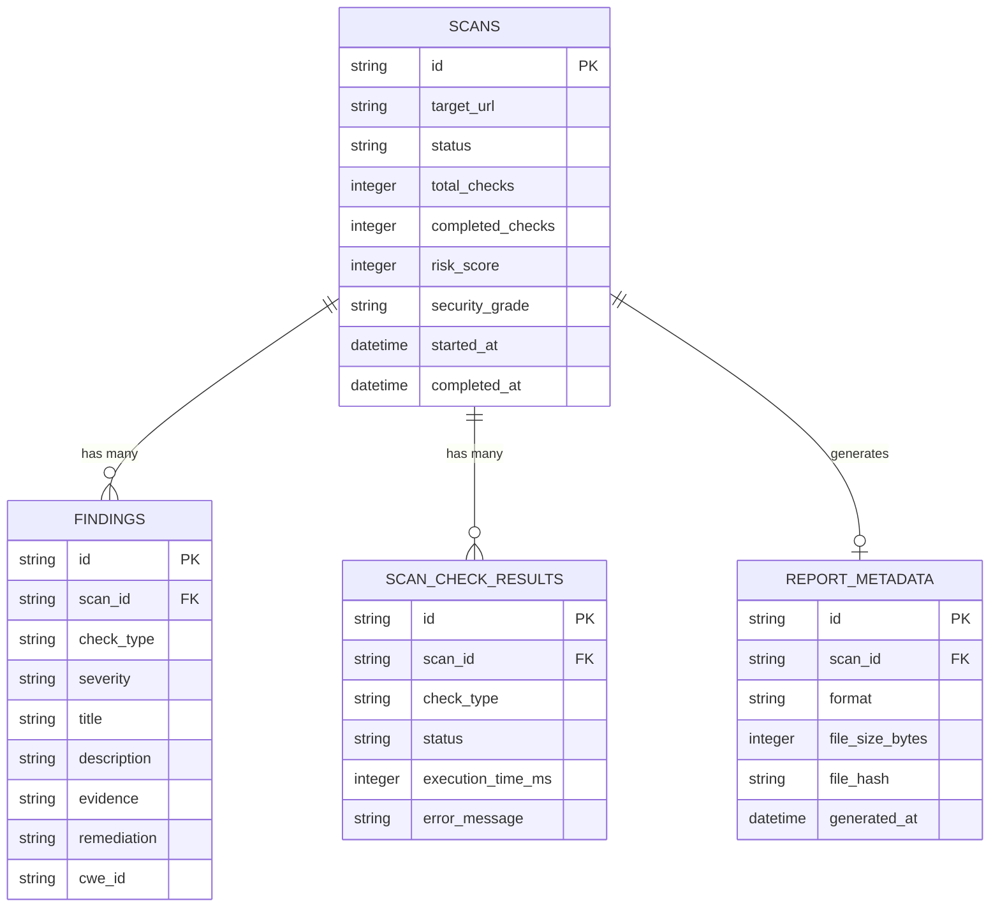

# SentinelScan — System Architecture & Design Document

## 1. Executive Architecture Summary

SentinelScan is engineered as a modern, decoupled, defense-in-depth web security assessment platform. It enables security engineers, DevSecOps practitioners, and web administrators to run rigorous, non-destructive security audits against web applications with zero credential leakage, strict SSRF immunity, and deterministic vulnerability explanations.

```
+------------------------------------------------------------------------------------+
|                                CLIENT TIER (SPA)                                   |
|   React 19 + TypeScript + Vite + Tailwind CSS v4 + Lucide Icons + Recharts         |
|   (Dashboard, Scan Launcher, Check Matrix, Findings Explorer, PDF/JSON Downloader) |
+------------------------------------------+-----------------------------------------+
                                           | HTTP / REST (Axios)
                                           v
+------------------------------------------------------------------------------------+
|                                 APPLICATION TIER                                   |
|   FastAPI Application Server (Uvicorn ASGI)                                        |
|   - Defensive Response Headers Middleware (CSP, HSTS, XCTO, XFO, Referrer)         |
|   - Centralized Exception Handling & Sanitized Structured Logging                  |
|   - Sensitive Data Masking (Cookie & Token Redaction Filter)                       |
+--------------------+-------------------------------------+-------------------------+
                     |                                     |
                     v                                     v
+--------------------+--------------+   +------------------+-------------------------+
|      SCAN ENGINE SUBSYSTEM        |   |           DATA PERSISTENCE                 |
| - TargetValidator (SSRF Barrier)  |   | SQLAlchemy 2.0 ORM Engine                  |
| - SafeHttpClient (HTTPX Sandbox)  |   | (SQLite / PostgreSQL Support)              |
| - Check Orchestrator (Semaphore)  |   | Alembic Schema Versioning                  |
| - 7 Modular Security Check Suites |   | Tables: scans, findings, scan_check_       |
| - Explanation & Remediation Engine|   |         results, report_metadata           |
+--------------------+--------------+   +--------------------------------------------+
                     |
                     v Outbound Controlled Audit Probes
+--------------------+---------------------------------------------------------------+
|                        EXTERNAL TARGET INFRASTRUCTURE                              |
|   Non-Destructive HTTP/S Inspection, Header Probing, TLS Handshake Verification    |
+------------------------------------------------------------------------------------+
```

---

## 2. Core Architectural Components

### 2.1 Backend Application (`backend/app/`)
* **Framework**: FastAPI (async ASGI) on Python 3.11+.
* **Security Middleware**: Every API response carries strict hardening headers:
  * `Content-Security-Policy: default-src 'self'`
  * `X-Content-Type-Options: nosniff`
  * `X-Frame-Options: DENY`
  * `Strict-Transport-Security: max-age=31536000; includeSubDomains`
  * `Referrer-Policy: strict-origin-when-cross-origin`
  * `Permissions-Policy: geolocation=(), microphone=(), camera=()`
* **Structured Logging with Redaction**: `SensitiveDataFilter` scrubs all session tokens, authorization headers, and cookies before log records hit stdout or files.

### 2.2 Scan Engine Subsystem (`backend/app/services/scanner/`)
* **`TargetValidator`**: Multi-phase target sanitizer:
  1. Syntactic scheme check (`http` or `https` only; rejects `file://`, `gopher://`, etc.).
  2. Credential rejection (blocks URLs with `user:pass@host`).
  3. Port allowlist & blocklist (permits 80, 443, 8080, 8443; rejects restricted ports like SSH, Redis, SMTP).
  4. DNS IP Resolution: Resolves hostname via socket and inspects every associated IP against:
     * Loopback (`127.0.0.0/8`, `::1`)
     * RFC 1918 Private Ranges (`10.0.0.0/8`, `172.16.0.0/12`, `192.168.0.0/16`)
     * Carrier-Grade NAT (`100.64.0.0/10`)
     * Link-Local & Cloud Metadata (`169.254.0.0/16`, `fe80::/10`)
     * Multicast, broadcast, and reserved testnets.
* **`SafeHttpClient`**: Controlled sandbox wrapping HTTPX:
  * Enforces maximum response limit (2 MB default) to prevent resource exhaustion attacks.
  * Disables automatic redirects to prevent blind SSRF bounce attacks; validates every hop destination explicitly against `TargetValidator` before following.
  * Enforces strict connection, read, and total timeouts (default 30 seconds).
* **`CheckOrchestrator`**:
  * Utilizes `asyncio.Semaphore` to cap concurrent scans across the process.
  * Regularly polls cancellation state from the database.
  * Spawns non-destructive check modules concurrently and persists standardized results and findings.

### 2.3 Modular Check Modules (`backend/app/services/scanner/checks/`)
1. **HTTPS Enforcement (`https_redirect.py`)**: Tests HTTP to HTTPS redirection, status codes (301/308 vs 302/307), and HSTS readiness.
2. **Security Headers (`security_headers.py`)**: Audits `Content-Security-Policy`, `Strict-Transport-Security`, `X-Content-Type-Options`, `X-Frame-Options`, `Referrer-Policy`, and `Permissions-Policy`.
3. **Cookie Security (`cookie_security.py`)**: Checks `Secure`, `HttpOnly`, and `SameSite` directives. Masks all raw cookie values in database and reports (`AUTH_TOKEN=***REDACTED***`).
4. **CORS Policy (`cors_config.py`)**: Probes CORS responses with controlled test origins (`https://evil-untrusted-origin.com` and `null`). Flags credentials reflection and wildcard misconfigurations.
5. **TLS Inspection (`tls_inspection.py`)**: Connects via SSL socket, evaluates certificate expiration countdown, SAN hostname coverage, and trust chain integrity.
6. **Information Disclosure (`info_disclosure.py`)**: Inspects response headers for exact server banners, framework versions (`X-Powered-By: Express`), and OS leakages.
7. **Response Hygiene (`response_hygiene.py`)**: Flags active debug panels, stack traces (`Traceback (most recent call last)`, `NullPointerException`), and protocol downgrades.

### 2.4 Reporting Engine (`backend/app/reports/`)
* **PDF Generator (`pdf_generator.py`)**: Builds audit-ready executive and technical PDF reports with ReportLab. Features branded cover pages, posture score cards, vulnerability distribution charts, and remediation roadmaps with automatic page numbering (`Page X of Y`).
* **JSON Generator (`json_generator.py`)**: Exports machine-readable, schema-valid audit manifests suitable for CI/CD pipeline gating and SIEM ingestion.

---

## 3. Data Model & Database Architecture

The persistence layer uses SQLAlchemy 2.0 with full async support and explicit foreign key constraints:



---

## 4. Concurrency, Reliability & Resiliency

1. **Backpressure & Resource Limits**: Scans are bounded by `MAX_CONCURRENT_SCANS` via asynchronous semaphores. If the queue is saturated, requests remain non-blocking.
2. **Graceful Cancellation**: If an operator clicks "Cancel Scan", the orchestrator terminates running subtasks, closes network connections immediately, and marks the scan as `CANCELLED`.
3. **Partial Failure Isolation**: If a single check (e.g., TLS certificate inspection on a non-TLS port) fails or encounters a socket timeout, other checks complete normally. The failed check records an error status without bringing down the scan.
